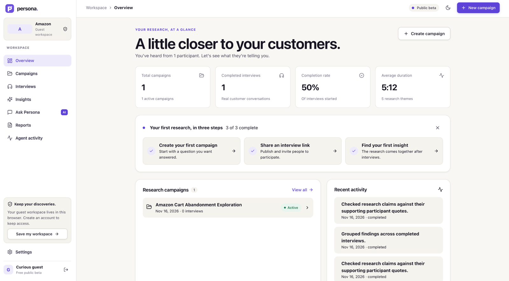
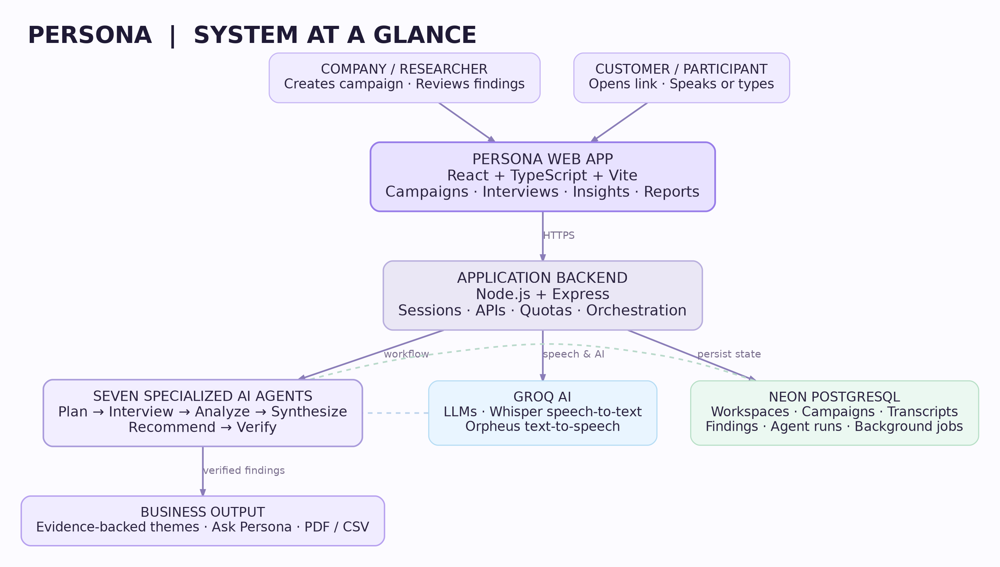
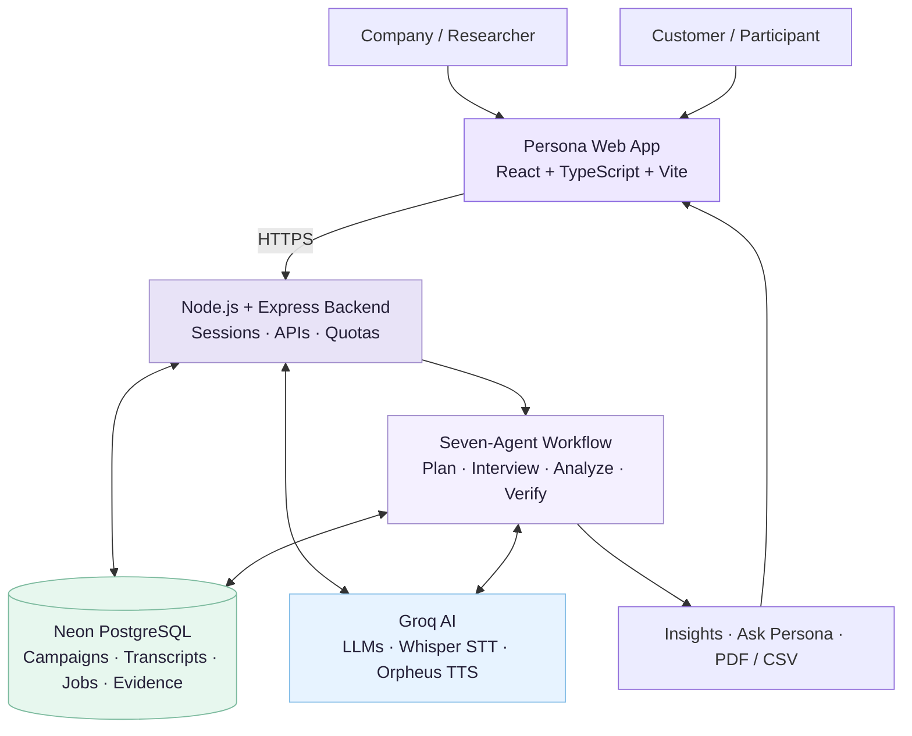

<div align="center">

# Persona

### Customer research that runs itself.

**An end-to-end AI research platform that turns customer conversations into evidence-backed product decisions.**

[**Try Persona live**](https://persona-research-beta.onrender.com) · [**How it works**](#how-it-works) · [**System architecture**](#system-architecture) · [**Run locally**](#run-locally)

**Public beta** · **Voice + text interviews** · **Seven specialized AI agents** · **Research with traceable evidence**

</div>



> **The idea in one sentence:** Describe what you want to learn, share an interview link with your customers, and let Persona interview them, analyze their feedback, and show you what matters—with supporting quotes.

## Why Persona?

Customer discovery often means scheduling interviews, taking notes, sorting transcripts, comparing recurring complaints, and preparing a report. Persona brings that workflow into one product:

- **For a company:** create a research campaign from a plain-English goal; edit and publish a tailored interview plan.
- **For a participant:** open a public link and have a guided, turn-by-turn AI interview by voice or text, without creating an account.
- **For a decision-maker:** review themes, supporting transcript evidence, prioritized improvement ideas, and downloadable research reports.

Persona is **not** a synthetic-customer simulator. Its findings come from conversations conducted with participants. Like any qualitative research tool, its recommendations are hypotheses to validate—not proof of what an entire market thinks.

## How it works

| Step | What happens | Example |
| --- | --- | --- |
| **1. Describe the research goal** | A company enters its product, audience, and research question. | “Why do shoppers abandon their carts?” |
| **2. Generate and review a plan** | The Research Strategist drafts objectives, assumptions, and open-ended questions. | Pricing, shipping, reviews, checkout friction. |
| **3. Publish and share** | Persona creates a public interview link and QR code. | A participant opens the link on their phone or laptop. |
| **4. Interview customers** | Persona asks a question, transcribes voice or accepts text, and chooses relevant follow-ups. | “How did the delivery fee affect your decision?” |
| **5. Synthesize evidence** | Agents classify findings, group themes, and check quotes against transcripts. | Delivery-cost surprise, trust in reviews. |
| **6. Make decisions** | The dashboard shows evidence-backed insights, Ask Persona answers, recommendations, and PDF/CSV exports. | Test upfront total-cost visibility. |

### Try the complete flow

1. Open [the live application](https://persona-research-beta.onrender.com) and create a research campaign in a guest workspace.
2. Review the generated interview questions, then **Publish campaign**.
3. Open the public interview link in another tab or device and complete a short voice or text interview.
4. Return to the workspace to inspect **Interviews → Research analysis → Insights → Ask Persona → Reports → Agent activity**.
5. Check whether each finding is supported by the participant's actual words. Repeat with different participants to see cross-interview themes emerge.

**Demo note:** The illustrated Amazon cart-abandonment campaign is fictional test research. Persona is not affiliated with Amazon, and demo answers should not be presented as real Amazon customer data.

## System architecture

Persona runs as a single web application and API hosted on **Render**, with **Groq** for AI inference and speech, and **Neon PostgreSQL** for durable application state.



<details>
<summary><strong>Editable architecture diagram (Mermaid)</strong></summary>



</details>

**In plain English:** The browser talks to the backend. The backend manages sessions, research workflows, data, and API access. AI steps use Groq. Completed work and its evidence are stored in PostgreSQL. The dashboard reads those results; the model itself is not the database.

For a deeper explanation of the interview pipeline, agent orchestration, persistence, and failure handling, see [**Architecture notes →**](docs/ARCHITECTURE.md).

## Seven specialized agents

Persona separates the research workflow into distinct responsibilities rather than asking one general-purpose chatbot to do everything.

| Agent | Responsibility |
| --- | --- |
| **01 · Research Strategist** | Turns a research brief into objectives, assumptions, questions, and a follow-up plan. |
| **02 · Voice Interviewer** | Produces natural, focused interview turns, one question at a time. |
| **03 · Adaptive Reasoning** | Uses earlier answers and research objectives to decide what to ask next. |
| **04 · Interview Analyst** | Extracts pain points, needs, positive feedback, requests, and transcript evidence. |
| **05 · Research Intelligence** | Groups findings across interviews, highlights differing views, and supports research Q&A. |
| **06 · Product Strategy** | Produces prioritized improvement suggestions, rationale, and next steps. |
| **07 · Evidence Verification** | Checks that research claims and citations are supported by source transcripts. |

These are **logical AI workflow stages**, not seven separately hosted servers. Individual executions are visible in the application's **Agent activity** page.

## Technology

| Layer | Stack | Role |
| --- | --- | --- |
| Web experience | React 19, TypeScript, Vite | Campaign builder, participant interview room, dashboards. |
| Application API | Node.js, Express 5 | Authentication, authorization, workflows, limits, exports. |
| Model inference | Groq-hosted GPT-OSS models | Question planning, follow-ups, analysis, synthesis, verification. |
| Speech-to-text | Groq Whisper | Converts recorded participant audio into text. |
| Text-to-speech | Groq Orpheus; browser speech fallback | Speaks interview questions when available. |
| Database | Neon PostgreSQL | Workspaces, sessions, campaigns, transcripts, agent runs, evidence, background jobs. |
| Hosting | Render | Unified HTTPS deployment for frontend and backend. |
| Validation | TypeScript checks, automated tests, Playwright | API, voice, and browser acceptance coverage. |

*Stack and implemented safeguards are described in the initial build report. This document is based on that report and manual product testing; it does not replace an independent source-code or security audit.*

## Inside the interview pipeline

```text
Customer speaks or types
        ↓
Browser records a response (audio or text)
        ↓
Backend validates and stores the interview turn
        ↓
Groq Whisper transcribes audio, when audio is used
        ↓
Adaptive Reasoning + Voice Interviewer choose the next question
        ↓
Question is displayed and optionally spoken
        ↓
After completion: Analyze → Group themes → Recommend → Verify evidence
        ↓
Insights / Ask Persona / PDF and CSV reports
```

The application is **turn-based**, not an always-listening, full-duplex voice call. The voice interface also supports text responses. When generated speech is unavailable, the product can disclose and use browser speech synthesis as a fallback.

## Trust, privacy, and research quality

The delivered implementation includes:

- **Explicit participant consent** before an interview; a participant can withdraw and request deletion from the interview flow.
- **Workspace-scoped access controls** so research data belongs to its owning workspace.
- **Session and CSRF protections** for private application actions.
- **Ephemeral audio handling:** audio is processed for transcription and is not intended to be stored permanently.
- **Source-linked findings:** quotes are checked against stored transcript messages, with visible evidence links.
- **Careful conclusions:** interview counts are counts of actual supporting interviews; AI suggestions are marked as suggestions.

**Research limitation:** A handful of self-selected interviews cannot establish population-level percentages or a statistically representative result. Validate major decisions with additional research and experiments.

## Run locally

**Prerequisites:** a recent Node.js installation, npm, a PostgreSQL connection, and a Groq API credential.

```bash
git clone https://github.com/Premdoshi1208/persona-research.git
cd persona-research
npm ci
cp .env.example .env
```

Set the environment variables documented in [`.env.example`](.env.example), keeping credentials server-side. **Never commit `.env` or API keys.** Inspect the available scripts with `npm run`, then start the development server using the script declared in `package.json` (typically `npm run dev`).

### Checks

The initial release report documents these scripts:

```bash
npm run typecheck
npm run lint
npm test
```

`npm run test:live` runs live provider integration tests and can consume Groq API usage; run it only when intentionally testing real model/speech calls.

### Deployment

The repository includes [`render.yaml`](render.yaml) for Render deployment configuration. The database is hosted separately on Neon; persistent application data and recoverable workflow jobs are not intended to depend on Render's ephemeral filesystem.

A health endpoint is exposed at [`/api/health`](https://persona-research-beta.onrender.com/api/health). Availability can vary while the free-tier service wakes up or when provider quotas are reached.

## Repository layout

```text
client/            React user interface
server/            Application backend and AI orchestration
evidence/          Test and release evidence
infra/             Deployment and infrastructure support
public/            Public/static assets
tests/             Automated tests
.env.example       Configuration template
render.yaml        Render deployment specification
package.json       Scripts and dependencies
```

## What is ready, and what's next?

**Implemented and manually exercised:** campaign generation, publishing, public interview participation, transcript persistence, per-interview analysis, multi-agent execution history, campaign insights, Ask Persona, and downloadable research reports.

**Beta limitations worth testing further:** cold-start delays on free hosting, speech-provider quotas and fallbacks, occasional slow interview turns, mobile/browser compatibility, and load testing under real concurrency. The live product is a **public beta**, not a claim of enterprise certification or a formal security audit.

---

<div align="center">

**Listen to customers. Understand the evidence. Build what matters.**

[**Launch Persona ↗**](https://persona-research-beta.onrender.com)

</div>
