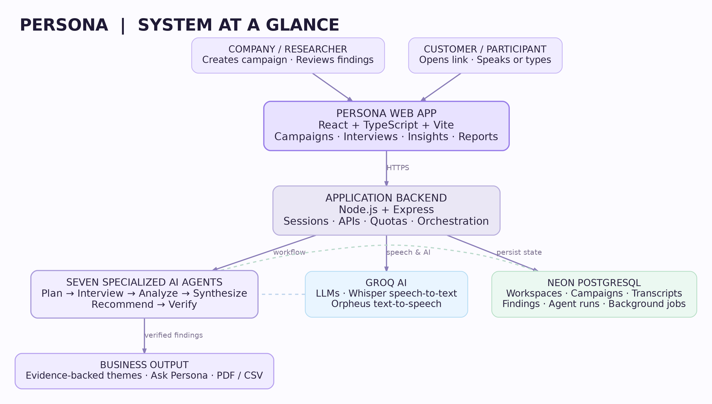

# Persona architecture — a simple technical walkthrough

> **Audience:** engineers, product leaders, and CTOs reviewing the public beta.
>
> **Scope:** conceptual system design grounded in the initial release report and visible product flows. Exact module internals and the current production revision should be confirmed against code before treating this as an independent audit.

## The system in one picture



**The simplest explanation:** a company creates a research campaign, participants answer questions, the backend runs AI workflows, Neon stores the evidence, and the company sees insights and reports. Groq provides model inference and speech, not workspace or business logic.

## Three flows that explain the whole product

### A. Company creates a research campaign

1. The researcher enters a plain-English goal in the React dashboard.
2. The Express API validates the request and checks workspace/session limits.
3. The **Research Strategist** generates a draft interview plan using a Groq-hosted LLM.
4. The researcher edits the campaign and publishes it.
5. The API persists the campaign and creates a public participant link.

**Stored objects:** workspace, campaign, objectives, questions, assumptions, and publishing state.

### B. Customer completes a turn-based interview

1. Participant opens the share link, reads the privacy information, and consents.
2. The browser uses `MediaRecorder` for audio or accepts typed input.
3. The API receives audio/text; Groq Whisper transcribes audio into a message when needed.
4. **Adaptive Reasoning** evaluates the answer and research objectives; **Voice Interviewer** composes the next question.
5. The browser displays it, optionally plays generated Orpheus speech (or disclosed browser speech fallback), and collects another answer.
6. On completion, the transcript and interview metadata remain available to the research workspace.

**Important distinction:** the current experience is conversational **turn-taking**, not a continuously streaming phone call. Audio can fail or hit provider limits independently of text-based interviewing.

### C. Completed interviews become evidence-backed research

1. **Interview Analyst** extracts needs, pain points, requests, positives, and participant quotes.
2. **Research Intelligence** groups themes across completed interviews and identifies gaps or differing views.
3. **Product Strategy** proposes prioritized actions, explicitly labeled AI suggestions.
4. **Evidence Verification** checks source quotations and generated claims; deterministic code calculates counts.
5. The system persists findings and serves them through **Insights**, **Ask Persona**, **Reports**, and **Agent activity**.

The release report describes PostgreSQL-backed recoverable jobs using leases and `FOR UPDATE SKIP LOCKED`. This avoids relying only on an in-memory task when the hosting instance restarts.

## Who owns what?

| Layer | Responsibility | Where it runs |
| --- | --- | --- |
| Browser UI | Screens, microphone controls, research review | User's browser |
| API and workflow orchestration | Session validation, permissions, business logic, job coordination | Render-hosted Node.js service |
| AI inference and speech | Language reasoning, transcription, optional spoken questions | Groq API |
| Durable state | Workspaces, interviews, messages, findings, jobs, usage | Neon PostgreSQL |

The seven agents are **application workflows using AI model calls**, not independently deployed microservices.

## Practical design decisions

- **Single origin:** application and API are served together, simplifying browser deployment and session handling.
- **Database-backed research:** transcripts, citations, findings, and execution history can be accessed after a browser reload.
- **Exact-quote evidence:** findings link back to participants' transcript messages rather than relying only on an ungrounded summary.
- **Separation of roles:** private researcher workspaces and public interview participation have different access scopes.
- **Consent first:** interviews disclose AI use, process audio for transcription, and support participant withdrawal/deletion.
- **Usage limits:** application-level budgets and retry/backoff logic protect free or rate-limited AI providers.

## Reliability and failure cases

| Failure case | Expected behavior or engineering priority |
| --- | --- |
| Render free instance asleep | Cold start may delay the first response; display a clear loading state. |
| Groq speech generation unavailable | Disclose browser voice fallback or let participant continue with text. |
| Microphone permission denied | Offer text interviewing instead of blocking the participant. |
| Slow inference or rate limit | Use bounded retries, explicit timeout and a recoverable error state. |
| Worker interrupted | Persist job state and resume safely from PostgreSQL. |
| Weak research sample | Show participant counts and warn against market-wide conclusions. |
| Transcript and analysis disagree | Prefer source messages and surface evidence-verification failures. |

**Known manual-test concerns:** one interview was observed waiting on “Considering your response…”, and a campaign-list interview counter did not match the overview count in one test. These are verification items for reliability, not evidence that the underlying product concept is invalid.

## Testing and review

The initial release report describes TypeScript/lint checks, automated API tests, real-provider voice tests, and browser acceptance coverage. The repo includes `tests/` and `evidence/` folders.

```bash
npm ci
npm run typecheck
npm run lint
npm test
# Optional; triggers real external model/speech calls:
npm run test:live
```

**Review checklist for a CTO:** inspect `server/ai.ts` and `server/jobs.ts` for model calls and task orchestration; inspect session, privacy, and workspace isolation middleware; review the database schema and `render.yaml`; then run the tests and a fresh two-participant acceptance journey.

## Research quality caveat

A demonstration with fictional Amazon shoppers is a **product test**, not an Amazon research study and not an Amazon endorsement. Persona's business value is in automating the collection and analysis of real participants' feedback while preserving evidence and exposing uncertainty.
